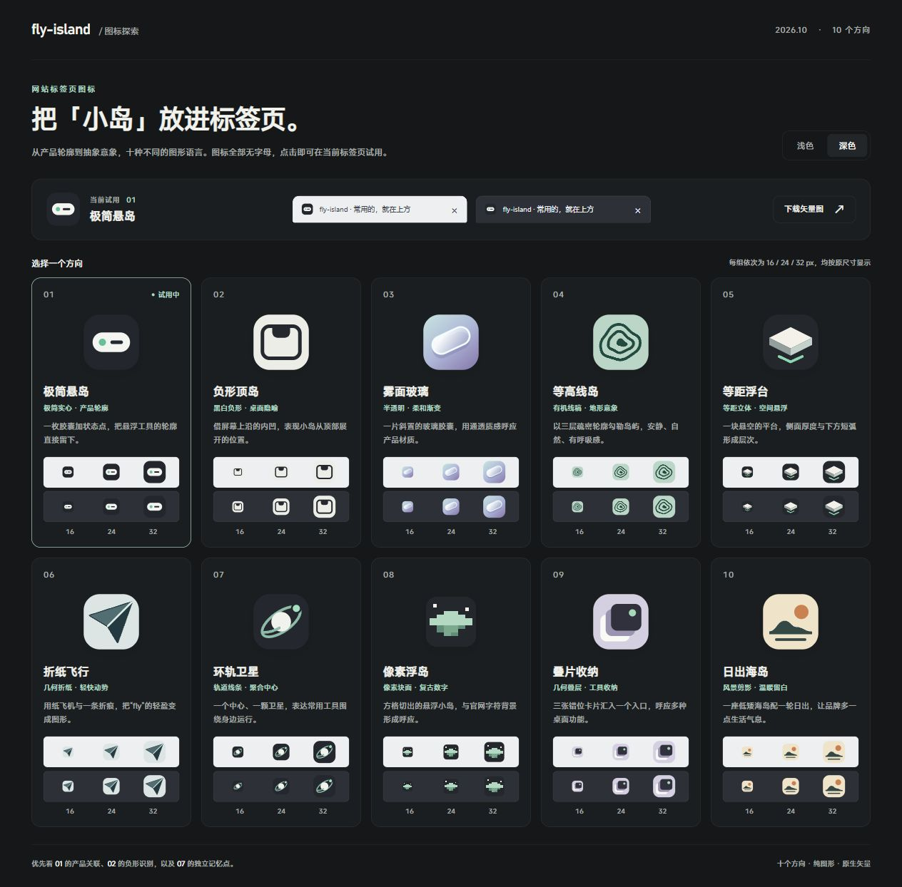

# fly-favicon

[简体中文](README.md) | **English**

Design SVG favicons in distinct styles and deliver an interactive page where people can compare, try, and download them.

**[Try the live demo →](https://flyl1u.github.io/fly-favicon)** · [Read the skill](SKILL.md) · [Manifest format](references/manifest.md)

[](https://flyl1u.github.io/fly-favicon)

This is the complete example created for [fly-island](https://github.com/flyl1u/fly-island). Click the image to open the interactive page and try any candidate as the actual browser-tab favicon. The demo interface is in Chinese.

## What you get

By default, the skill designs **10 SVG favicons without letters or numbers**, based on the website's subject and visual identity. Candidates explore different shapes and visual languages. You can specify the count, palette, and whether text is allowed.

| Feature | Behavior |
| --- | --- |
| Side-by-side comparison | Each direction has a name, a short rationale, and a large preview. |
| Actual-size previews | Every icon appears at 16 / 24 / 32 CSS px on both light and dark backgrounds. |
| Real favicon switching | Selecting a candidate updates the page favicon, title, selected state, and download target. |
| Light and dark themes | Switch the page background; the header also shows both tab-bar treatments. |
| Restorable selection | URL parameters such as `?icon=02` preserve the selected candidate across reloads. |
| Portable assets | Download individual SVGs or copy the entire output folder for offline use. |

The AI agent using this skill designs the artwork from the website's context. The Python builder validates the assets and assembles the comparison page. It uses only the Python standard library; the generated page needs no npm packages, CDN, API, or build step.

## Install

Clone this repository into your personal Codex skills directory.

**macOS / Linux**

```sh
git clone https://github.com/flyl1u/fly-favicon.git ~/.codex/skills/fly-favicon
```

**Windows PowerShell**

```powershell
git clone https://github.com/flyl1u/fly-favicon.git "$env:USERPROFILE\.codex\skills\fly-favicon"
```

If you set `CODEX_HOME`, use its `skills/fly-favicon` subdirectory instead. Invoke `$fly-favicon` in a Codex session that has discovered the installed skill.

## Use

Work inside a website repository, or provide a URL, screenshot, or product concept:

```text
Use $fly-favicon to design 10 symbol-only favicons for this website.
Deliver an interactive comparison page where I can try each option.
```

```text
Use $fly-favicon to design 6 icons for a reading-notes website.
Keep the feel quiet and simple; explore paper, bookmarks, and starlight.
Deliver a comparison page.
```

```text
Use $fly-favicon to refine options 02 and 07 from the previous round.
Preserve their recognizable shapes and improve clarity at 16px.
```

The skill reads the available website and brand context, designs the candidates, builds the page, and checks the result. Design and comparison requests preserve the production favicon. A request to implement a specific option also authorizes the corresponding integration.

## Run the builder directly

If you already have SVG artwork and a manifest, generate the page directly with Python 3.9 or later.

From the repository root, rebuild the ten demo candidates into a new comparison page:

```sh
python scripts/build_comparison.py --manifest docs/manifest.json --output output/demo
```

Open `output/demo/index.html`, or serve it locally:

```sh
python -m http.server 8000 --directory output/demo
```

Visit <http://localhost:8000>. The output directory must be new; choose another output path for another run. On Windows, use `python -X utf8` if the terminal has encoding issues.

For your own project, prepare JSON and SVGs using the [manifest format](references/manifest.md), then change the `--manifest` path.

## Repository layout

```text
fly-favicon/
├── SKILL.md                   # Skill instructions
├── agents/openai.yaml         # Codex display and invocation metadata
├── assets/comparison/         # HTML / CSS / JS comparison template
├── scripts/build_comparison.py
├── references/manifest.md     # Input format
└── docs/                      # Live demo, ten SVGs, screenshot, and example manifest
```

`docs/` preserves the fly-island example. The template and builder work with other websites and do not impose an island theme.

## License

[MIT](LICENSE)
