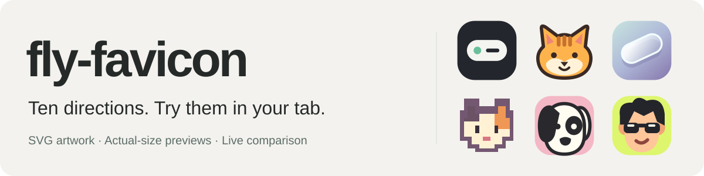
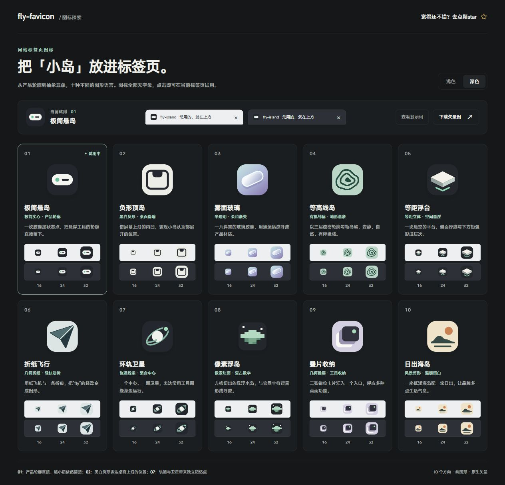

<p align="right"><a href="README.md">中文</a> · <strong>English</strong></p>



**One prompt to explore favicon styles that fit your website.** By default, the skill designs 10 SVG candidates without letters or numbers and delivers an interactive page to compare, try, and download them.

## See the results

### 01 / Cats, dogs, and faces with character

Ten head portraits explored for a personal website: three cats, three dogs, and four people, with freedom to move beyond the site's palette and style.

[Live preview](https://flyl1u.github.io/fly-favicon/living-heads-01/)

[](https://flyl1u.github.io/fly-favicon/living-heads-01/)

Exact original prompt:

> 使用fly-favicon为该项目（网站）探索10种标签页图标，要活物，人，或者小猫，小狗，不要全身，要头，颜色和风格不要被网站风格局限

### 02 / From islands to orbits

Ten favicon designs explored for [fly-island](https://island.flyliu.org/).

[Live preview](https://flyl1u.github.io/fly-favicon)

[](https://flyl1u.github.io/fly-favicon)

Exact original prompt:

> 使用fly-favicon，为该项目探索标签页图标

### 03 / Ten takes on the pixel player

Nine new head-icon styles explore pixel art, voxels, vinyl toys, comics, neon, and more, alongside the original red-cap player for a total of ten.

[Live preview](https://flyl1u.github.io/fly-favicon/pixel-player-styles-03/)

[](https://flyl1u.github.io/fly-favicon/pixel-player-styles-03/)

Exact original prompt and follow-up requests:

```text
像素玩家不错，在此基础上探索9种不同风格的图标，使用fly-favicon
```

## How to install the skill

Copy this prompt into Codex:

```text
Please use the following command to install fly-favicon for Codex and confirm that installation succeeded:
npx skills add flyl1u/fly-favicon
```

## How to use it after installation

In Codex, type `@` and select `fly-favicon`. Then specify a style or ask it to explore designs based on your website's style.

**Specify a style:**

```text
Explore favicons for this project using cat, dog, and human heads only.
Try pixel art, stickers, and geometric styles, then deliver an interactive
comparison page where I can try each option.
```

**Explore the website's style:**

```text
Explore 10 favicons based on this website's content, colors, and style.
Deliver an interactive comparison page where I can try each option.
```

## License

[MIT](LICENSE)
