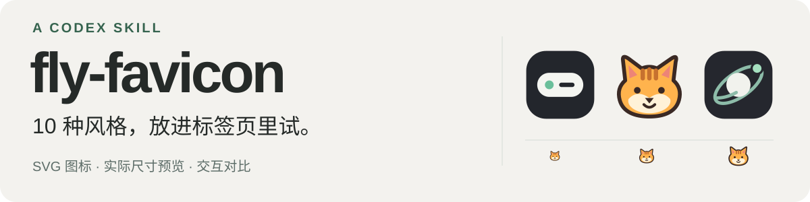

<p align="right"><strong>中文</strong> · <a href="README.en.md">English</a></p>



**一句提示词，为你的网站标签页设计适配的多风格的图标** 默认设计 10 种无字母、无数字的 SVG 候选，并交付可以比较、点击试用和下载的交互页

## 先看效果

### 01 / 猫、狗和有性格的脸

为个人网站探索的 10 张头像：3 只猫、3 只狗、4 位人物，只画头部，放开网站配色与画风。

[在线预览](https://flyl1u.github.io/fly-favicon/living-heads-01/)

[](https://flyl1u.github.io/fly-favicon/living-heads-01/)

原始提示词：

> 使用fly-favicon为该项目（网站）探索10种标签页图标，要活物，人，或者小猫，小狗，不要全身，要头，颜色和风格不要被网站风格局限

### 02 / 从小岛到卫星

为网站： [fly-island](https://island.flyliu.org/) 探索的十种图标

[在线预览](https://flyl1u.github.io/fly-favicon)

[](https://flyl1u.github.io/fly-favicon)

原始提示词：

> 使用fly-favicon，为该项目探索标签页图标

## 如何安装该 Skill

将下面这段提示词复制给 Codex：

```text
请帮我安装这个 Codex Skill，并确认安装成功：
https://github.com/flyl1u/fly-favicon
```

## 安装后如何使用

在 Codex 中先输入 `@` 并选择 `fly-favicon`，再指定风格，或让它根据网站风格探索。

**指定风格：**

```text
为该项目探索标签页图标，尝试小猫、小狗和人物头像，只画头部，
使用像素、贴纸和几何风格，最后生成可点击试用的交互对比页。
```

**根据网站风格探索：**

```text
根据当前网站的内容、配色和风格，探索 10 种标签页图标，
最后生成可点击试用的交互对比页。
```

## 许可

[MIT](LICENSE)
